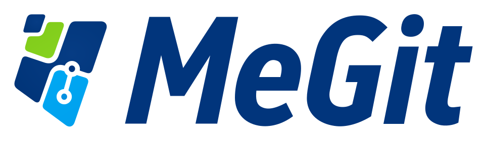
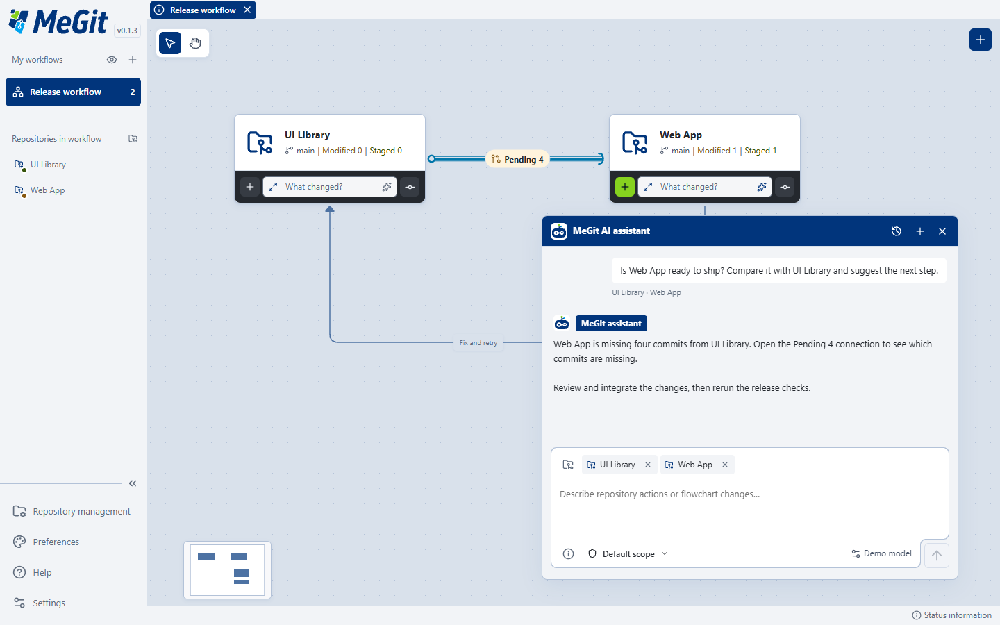
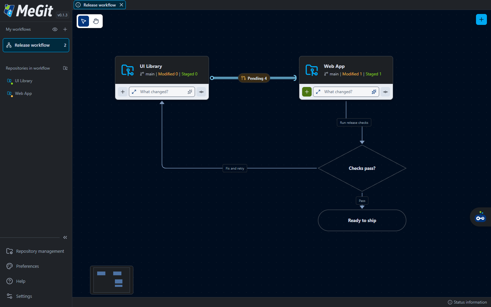

<p align="center">
  
</p>

<p align="center"><strong>A visual Git workbench for multi-repository workflows</strong></p>
<p align="center">Map dependencies, verify what has landed, and inspect local Git history from one board.</p>

<p align="center">
  <a href="#quick-start"></a>
  <a href="#local-by-default"></a>
  <a href="README.zh-CN.md"></a>
</p>

<p align="center">
  <a href="#quick-start">Quick start</a> · <a href="#features">Features</a> · <a href="#product-gallery">Screenshots</a> · <a href="README.zh-CN.md">简体中文</a>
</p>


## Features

- **Workflow canvas** — Keep multiple boards open in tabs, group repositories, map dependencies and release steps, and export boards as SVG or PNG. Each tab has workflow information on the left and a close button on the right. Closing the tab does not delete the board.
- **Integration checks** — See which source commits are missing from a target. Open the connection to inspect the comparison.
- **Connection shortcuts** — Pending push (blue, right) and pull (green, left) are visible without hovering when they can run. If a direction has no pending commits, its shortcut appears in gray on hover or keyboard focus and cannot be activated. Pull status reflects the last fetch. For two local repositories, edit the connection and enable fast-forward integration to move source commits into the checked-out target. Every action shows its direction and requires confirmation; the connection remains a comparison entry point.
- **Git workbench** — Compare with the trunk or view the latest commit’s diff using the buttons beside each branch label. Stage changes, commit, and manage branches and remotes in the same workbench. Pull highlights in green when there are incoming commits, and Push highlights in blue when there are outgoing commits. Both show the sync direction and require confirmation. Fetch runs directly.
- **Optional AI assistant** — Ask about selected repositories, draft commit messages, and review proposed actions before applying them.

## Quick start

### Windows desktop

Run the Windows x64 installer, then open **MeGit** from the Start menu. The desktop app bundles its Node.js runtime and uses your existing Git for Windows installation. See the [desktop installation and build guide](desktop/README.md).

### Browser

Requires **Node.js 22.12+** and **Git** on your `PATH`.

```sh
git clone https://github.com/tojayon/MeGit.git
cd MeGit
npm ci
npm run build
npm start
```

Open **[127.0.0.1:4317](http://127.0.0.1:4317)**. On Windows, you can also double-click [`Start-MeGit.cmd`](Start-MeGit.cmd) in the checkout.

Add two local repositories and connect them with a **Code integration** edge to compare their Git refs by commit ancestry.

## Product gallery

### AI assistant



*Demo conversation: two repository references, a release-readiness question, and a suggested next step.*

| Branch map | Integration comparison |
| :---: | :---: |
| [](docs/screenshots/branch-map.png) | [](docs/screenshots/integration.png) |

<details>
<summary>Git visual classroom and dark mode</summary>

**Git visual classroom** — Step through a merge without touching a repository.


**Dark mode** — The same release board in the dark theme.



</details>

## Local by default

**AI project delivery** is off by default. Enable it in **Settings → AI service**, then open **Project delivery** in the existing AI chat. Authorize one registered repository and the displayed AI provider, review the proposed new or modified text files, then confirm which action to take. A generated PowerShell entry can also be saved to that repository’s local startup settings after explicit trust. Saving does not run the script, stage changes, commit, or push.

MeGit binds to `127.0.0.1` and saves boards locally. Git uses your existing configuration and credentials. An AI provider receives task context only when you use a configured AI feature.

On Windows, open **Local service** in a repository's details to approve an existing npm script or a repository PowerShell script. Start, stop, or restart the managed foreground service and read its output directly in the terminal panel. An optional TCP port enables readiness and conflict checks; MeGit does not stop unrelated listeners or launch services automatically.

Once configured, use the play icon below the repository details button on the right of its current HEAD board card. While the service runs, the play icon becomes a Stop button and the card background shows a subtle green glow that gently pulses (static with reduced motion). Errors appear on the card; Restart, configuration, and full output stay in the Local service panel.

See the [local service script specification](docs/LOCAL_SERVICE_SCRIPTS.md) for entry rules and working npm and PowerShell examples.

Each active service has its own terminal tab on the left side of the board's footer. Select a tab to open that repository's terminal directly. Save and check details are under **Status information** on the right.

## Development

`npm run dev` starts the app. `npm run check` runs the project checks; `npm run test:e2e` runs the Edge scenarios.

[User guide (简体中文)](README.zh-CN.md) · [Architecture](docs/ARCHITECTURE.md) · [Design system](docs/DESIGN_SYSTEM.md)
