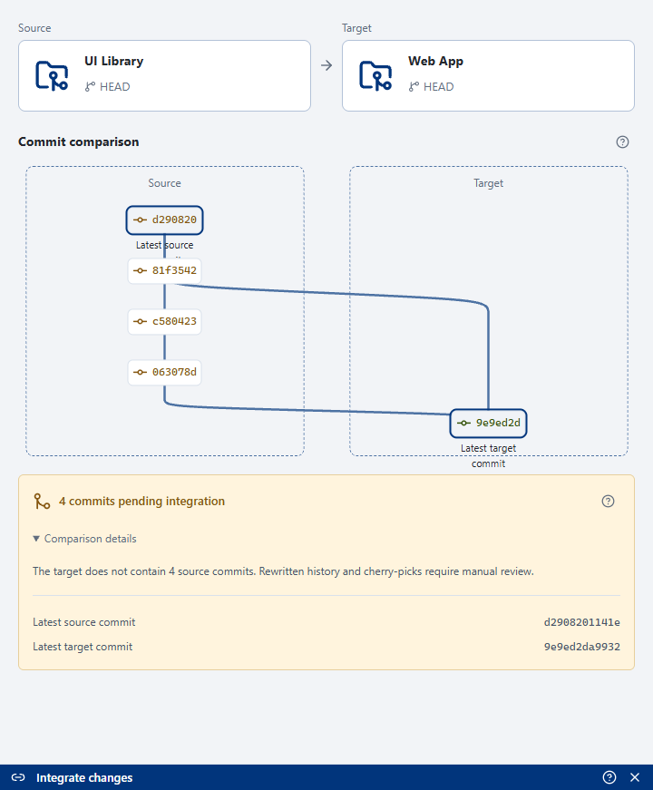

<p align="center">
  
</p>

<p align="center"><strong>A visual Git workbench for multi-repository workflows</strong></p>
<p align="center">Map dependencies, verify what has landed, and inspect local Git history from one board.</p>

<p align="center">
  <a href="#quick-start"></a>
  <a href="#local-by-default"></a>
  <a href="README.zh-CN.md"></a>
</p>

<p align="center">
  <a href="#quick-start">Quick start</a> · <a href="#features">Features</a> · <a href="#product-gallery">Screenshots</a> · <a href="README.zh-CN.md">简体中文</a>
</p>


## Features

- **Workflow canvas** — Group repositories, map dependencies and release steps, and export boards as SVG or PNG.
- **Integration checks** — See which source commits are missing from a target. Open the connection to inspect the comparison.
- **Connection shortcuts** — Pending push (blue, right) and pull (green, left) are visible without hovering when they can run. If a direction has no pending commits, its shortcut appears in gray on hover or keyboard focus and cannot be activated. Pull status reflects the last fetch. For two local repositories, edit the connection and enable fast-forward integration to move source commits into the checked-out target. Every action shows its direction and requires confirmation; the connection remains a comparison entry point.
- **Git workbench** — Compare with the trunk or view the latest commit’s diff using the buttons beside each branch label. Stage changes, commit, and manage branches and remotes in the same workbench.
- **Optional AI assistant** — Ask about selected repositories, draft commit messages, and review proposed actions before applying them.

## Quick start

Requires **Node.js 22.12+** and **Git** on your `PATH`.

```sh
git clone https://github.com/tojayon/MeGit.git
cd MeGit
npm ci
npm run build
npm start
```

Open **[127.0.0.1:4317](http://127.0.0.1:4317)**. On Windows, you can also double-click [`Start-MeGit.cmd`](Start-MeGit.cmd) in the checkout.

Add two local repositories and connect them with a **Code integration** edge to compare their Git refs by commit ancestry.

## Product gallery

### AI assistant


*Demo conversation: two repository references, a release-readiness question, and a suggested next step.*

| Branch map | Integration comparison |
| :---: | :---: |
| [](docs/screenshots/branch-map.png) | [](docs/screenshots/integration.png) |

<details>
<summary>Git visual classroom and dark mode</summary>

**Git visual classroom** — Step through a merge without touching a repository.


**Dark mode** — The same release board in the dark theme.


</details>

## Local by default

MeGit binds to `127.0.0.1` and saves boards locally. Git uses your existing configuration and credentials. An AI provider receives task context only when you use a configured AI feature.

## Development

`npm run dev` starts the app. `npm run check` runs the project checks; `npm run test:e2e` runs the Edge scenarios.

[User guide (简体中文)](README.zh-CN.md) · [Architecture](docs/ARCHITECTURE.md) · [Design system](docs/DESIGN_SYSTEM.md)
