<p align="center"></p>

<h1 align="center">A visual Git workbench for multi-repository workflows</h1>

<p align="center">Put related repositories on one canvas, see what each branch is missing, and review the Git changes that move a release forward.</p>

<p align="center"><a href="#quick-start">Quick start</a> · <a href="#product-tour">Product tour</a> · <a href="#common-workflows">Common workflows</a> · <a href="https://github.com/tojayon/MeGit/releases">Download</a> · <a href="README.zh-CN.md">简体中文</a></p>

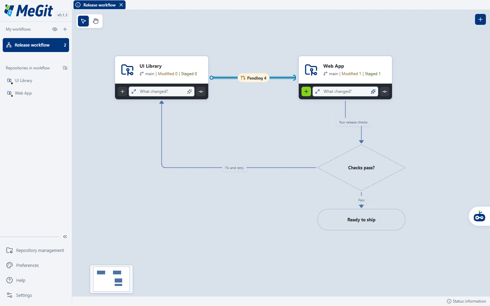

## What you can do with MeGit

MeGit is a local workbench for projects whose code and release steps span several Git repositories. Repository cards show branch and working tree state. Directed links show where changes need to go. Open a card to inspect Git history or open a code integration link to see which commits are missing.

- **See the whole project.** Group repositories, show several refs from the same repository side by side, and map build, test, and release decisions on the canvas. Open several workflows in tabs and export the visible canvas as SVG or PNG.
- **Follow changes down to the file.** Explore branch history, compare refs, inspect commit diffs, and move changes from the working tree to the staging area and into a commit.
- **Review before applying changes.** Check sync direction, inspect a local merge, preview an npm version bump, or review a proposed AI plan.

## Quick start

### Windows desktop

Download the Windows x64 installer and its matching `SHA256.txt` from [GitHub Releases](https://github.com/tojayon/MeGit/releases). Preview installers are unsigned. MeGit bundles Node.js and uses your installed Git for Windows. [Installation and checksum verification](desktop/README.md).

### Browser

You need Node.js **22.12+** and Git on your `PATH`.

```sh
git clone https://github.com/tojayon/MeGit.git
cd MeGit
npm ci
npm run build
npm start
```

Open [http://127.0.0.1:4317](http://127.0.0.1:4317). On Windows, [`Start-MeGit.cmd`](Start-MeGit.cmd) can install dependencies and build on first launch.

### Try your first workflow

1. Select **Add repository** and register two existing local Git repositories. To compare two refs in one repository, add a second card for the same repository and bind it to another branch.
2. Draw a **Code integration** link from the source card to the target card. The two refs need shared commit history for the comparison.
3. Select the link to inspect the result. If the target lacks an object needed for the comparison, fetch the source remote from the target repository and check again.

## Product tour

### 1. Map the route from code to release

Repository cards belong on the same canvas as notes, decision nodes, and retry paths. **Code integration** follows Git history. **Development dependency** and **Delivery** record how you organize the work. Groups keep related repositories together, while workflow tabs preserve a different view for each project or release.

<details>
<summary>See the release canvas in dark mode</summary>


</details>

### 2. Check what has landed and what is still missing

The integration panel compares the selected source and target refs by commit ancestry. Inspect their common history and the commits the target still needs. For two local repositories, you can enable fast-forward integration or prepare a merge, inspect its staged result, and choose whether to commit or abort. Delivery links document intended handoffs. Build and deployment status belongs to your release process.


### 3. Explore branches, merges, and individual changes

The branch map shows the actual forks and merges in Git history. Choose a comparison trunk without switching the checked-out branch. Select a branch to see its status, compare it with the trunk, or open the latest commit's diff. Expand a collapsed segment to inspect its commits in place.

<p align="center">
  <a href="docs/screenshots/branch-map.png"></a>
  <a href="docs/screenshots/branch-comparison.png">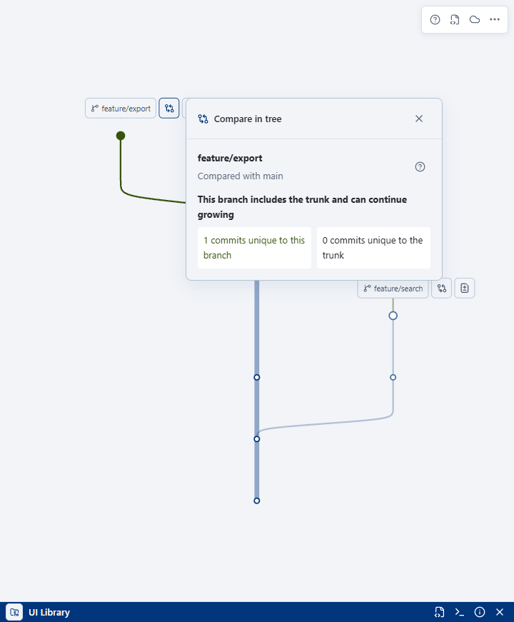</a>
</p>

<details>
<summary>See the commit diff and the dark branch map</summary>

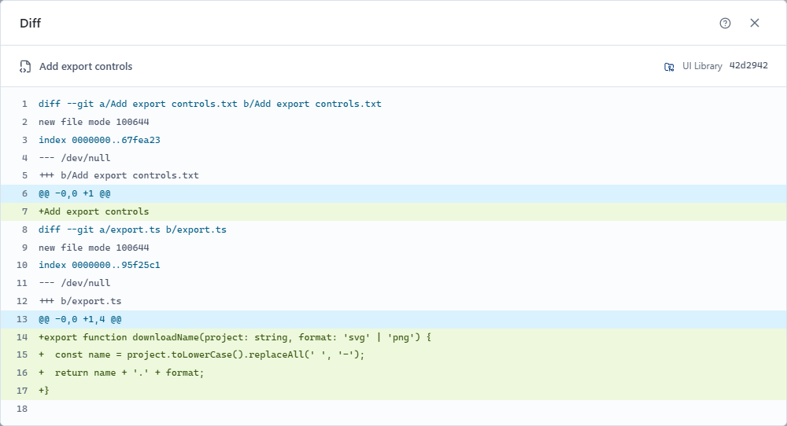

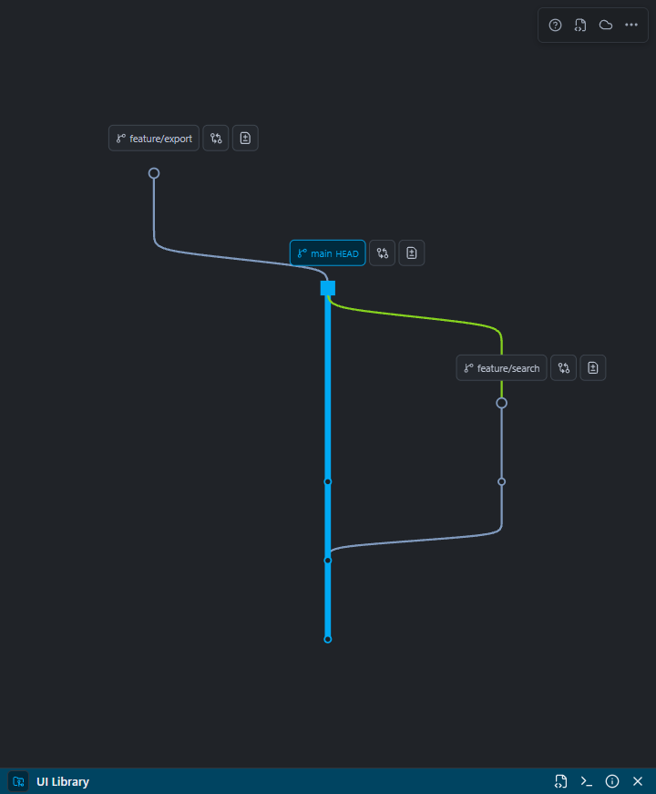

</details>

### 4. Review the working tree before committing

The working tree shows unstaged and staged files side by side. Read file diffs, stage or unstage changes individually or in bulk, and write a commit message. The repository card shares the same draft and provides a compact staging and commit entry point. Fetch updates local remote refs. Pull and push show the direction and ask for confirmation.

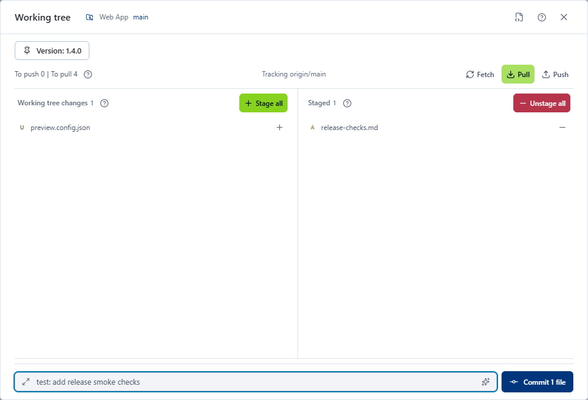

<details>
<summary>See the commit message editor and the dark working tree</summary>

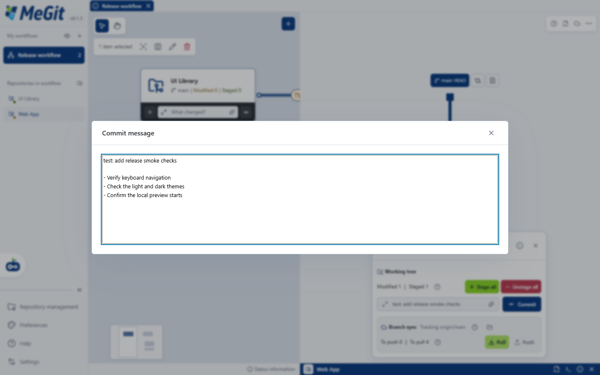

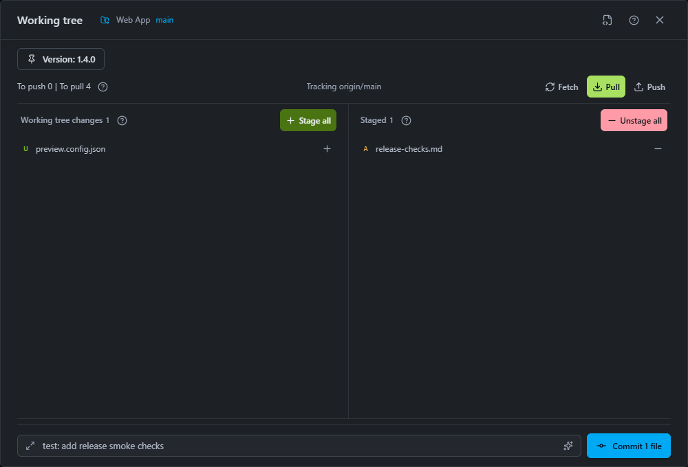

</details>

### 5. Edit small project files and preview version bumps

Open **Repository files** from the repository toolbar, select a file in the tree, and edit it in the adjacent pane. Existing, non-ignored UTF-8 text files up to 96 KiB are supported. Review the diff before saving. Click **Modified** or **Staged** on the repository card to open the working tree panel, where configured shortcuts appear. The npm shortcut updates `package.json` and any existing npm lockfiles together. A JSON shortcut edits a scalar such as `/release/channel` while preserving the surrounding formatting.

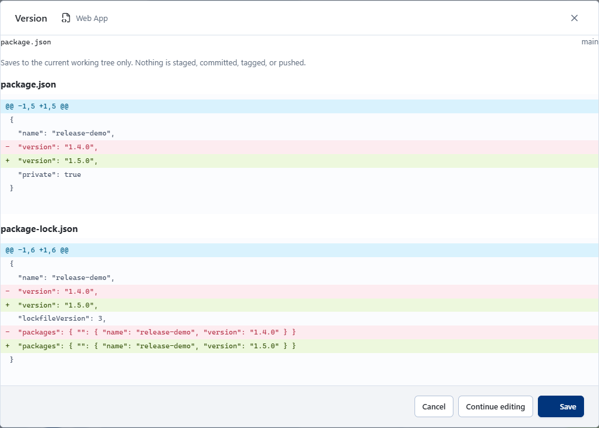

<details>
<summary>See the repository file tree and review a text edit before saving</summary>

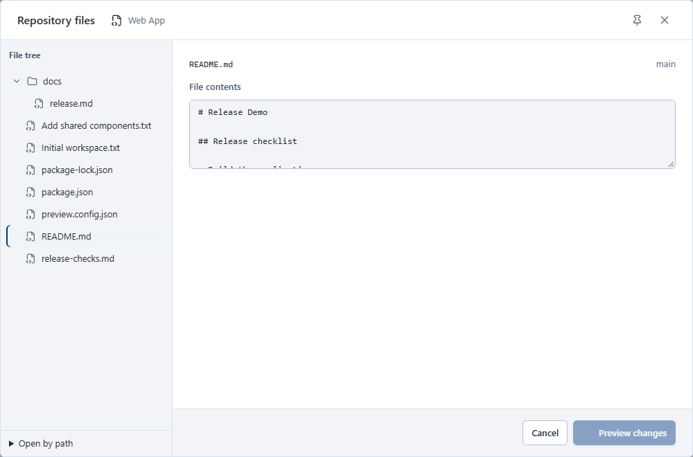

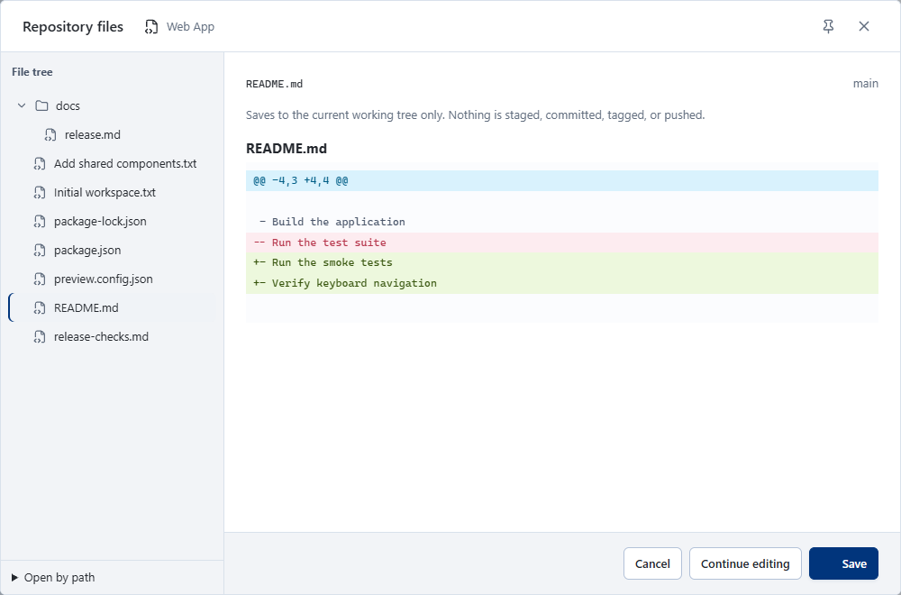

</details>

### 6. Ask the AI assistant with repository context

Reference the repositories you want to discuss. The assistant can summarize their state, draft a commit message, propose a workflow edit, or prepare a Git plan for actions such as staging, committing, and pushing to a configured upstream. Review the proposed changes and confirm them in MeGit. Project file editing is an optional capability for a single explicitly authorized repository.


<details>
<summary>See the AI assistant in dark mode</summary>

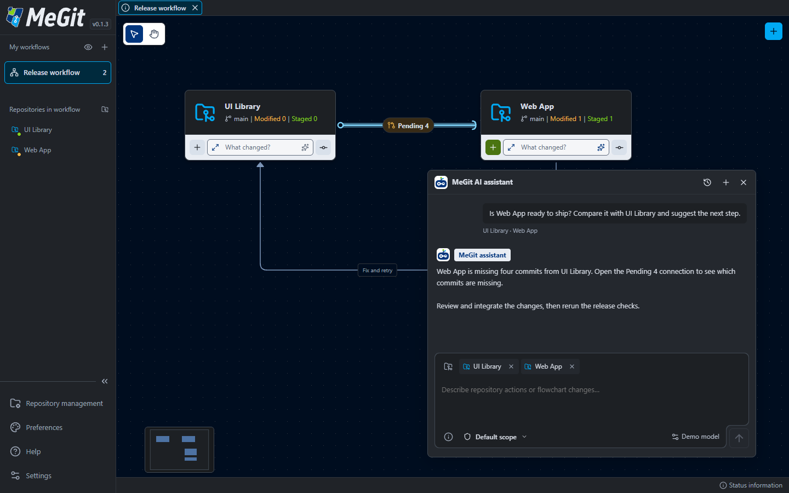

</details>

### 7. Run a local preview on Windows

Approve a repository's existing npm script or PowerShell launch entry. Start, restart, or stop it through MeGit, inspect its terminal output, and open the configured loopback address when the service is running. Active services are accessible from the workflow footer. [Local service scripts and examples](docs/LOCAL_SERVICE_SCRIPTS.md).

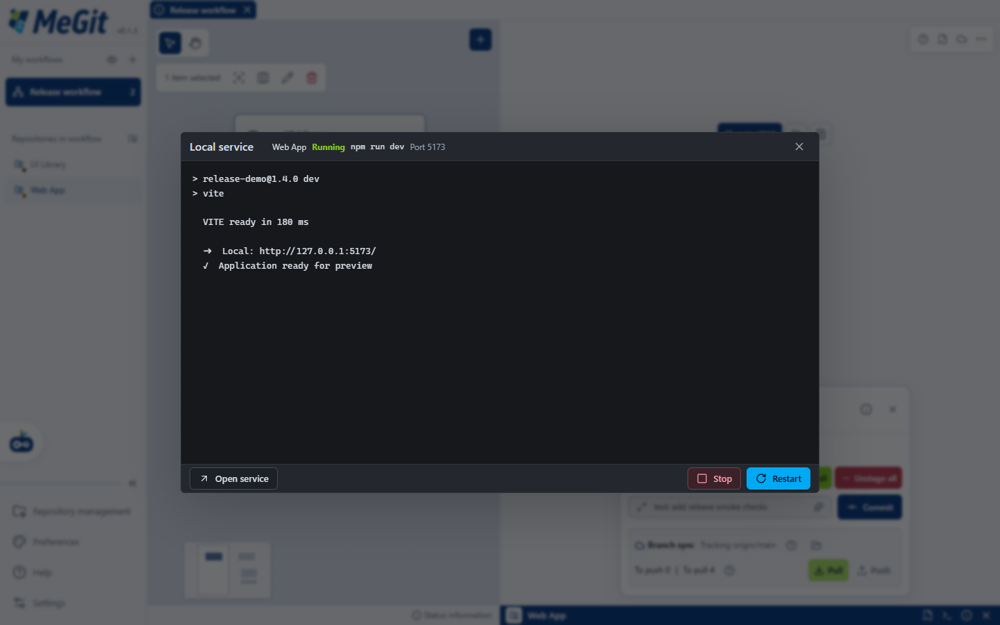

<details>
<summary>See the local service console in dark mode</summary>

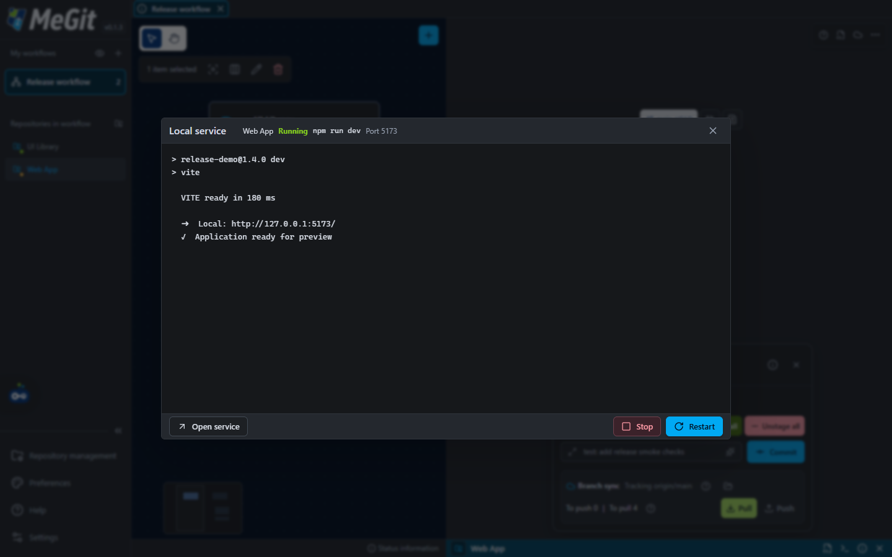

</details>

### 8. Learn Git visually and make the interface your own

The **Git visual classroom** lets you step through staging, snapshots, branch switches, merging, remote sync, undo, and conflict resolution with animated examples. Open **Preferences** to switch independently between English and Simplified Chinese, and between light and dark themes.

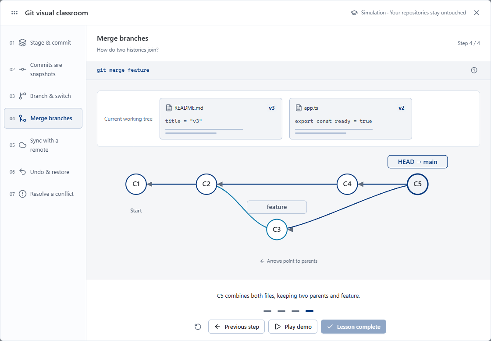

<details>
<summary>See language and theme preferences</summary>

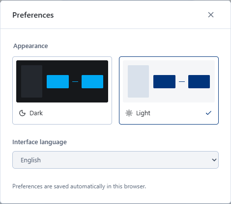

</details>

## Common workflows

- **Roll out a shared library update.** Link the library to each downstream app. Use the integration panels to see which apps still lack the relevant commits.
- **Maintain public and internal variants.** Map both repositories in one workflow and compare the refs that represent your shared baseline and the internal version.
- **Prepare a release.** Review the working tree, preview the package version change, start a local preview on Windows, and track checks with decision nodes.
- **Get comfortable with Git.** Practice a merge in the classroom, then use the branch map and command previews to inspect a real repository.

## Local data and AI

MeGit listens on `127.0.0.1` and stores workflows locally. A source checkout uses `.megit/` by default. Git uses your existing configuration and credentials. Fetch, pull, and push contact the remotes involved in those operations.

AI is optional. An AI request sends the context selected for that feature to the configured provider. This can include repository metadata, workflow text, file contents, or diffs. One-message permission to send a proposed commit diff can include unstaged and new files. Check the scope before sharing private code. Windows protects saved API keys with the current user's system credentials.

## Documentation and development

- [User guide (简体中文)](docs/USER_GUIDE.zh-CN.md) · [Windows desktop guide](desktop/README.md) · [Local service scripts](docs/LOCAL_SERVICE_SCRIPTS.md)
- [Architecture](docs/ARCHITECTURE.md) · [Design system](docs/DESIGN_SYSTEM.md) · [Screenshot gallery and capture instructions](docs/screenshots/README.md)

Run `npm run dev` to start the development server, `npm run check` for project checks, and `npm run test:e2e` for the Edge scenarios. Use isolated data and temporary repositories when testing.

## License

MeGit is distributed under the [MIT License](LICENSE). Bundled third-party components retain their own licenses.
