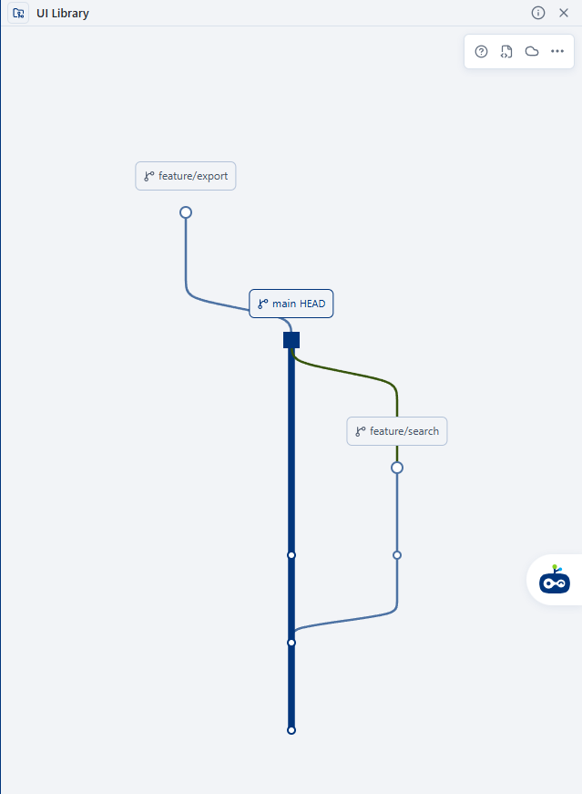

<p align="center"></p>

# See how your repositories work together

**MeGit is a local Git workbench built around a multi-repository canvas.** Most Git tools show what happened *inside* a repository. MeGit also shows what needs to happen *between* repositories: how a fix moves from a shared library to an app, what depends on it, and what ships next.

[](#quick-start)
[](#local-by-default)
[](README.zh-CN.md)

[Quick start](#quick-start) · [Screenshots](#product-gallery) · [Features](#features) · [简体中文](README.zh-CN.md)


*A release workflow on one board: Git verifies the integration between repositories, while the flowchart shows what to do next.*

<details>
<summary>Preview dark mode</summary>


</details>

## Product gallery

### AI assistant on the board

Reference more than one repository in a floating chat window without leaving the workflow. Ask what is blocking a release or review a proposed action before applying it.


*Illustrative conversation using demo repositories; no Git actions are run.*

| Branch map | Integration evidence |
| --- | --- |
| [](docs/screenshots/branch-map.png) | [](docs/screenshots/integration.png) |
| Follow branches, merges, and `HEAD` without changing your checkout. | Open a connection to inspect the commits behind its status. |

**Git visual classroom** — step through a branch merge, with no changes to your repositories.


## Features

- **Multi-repository canvas.** Reuse local repositories across boards, set custom icons, collapse groups without losing their external connections, and export a board for sharing.
- **Connections backed by Git.** Check whether a destination ref contains the source commits and inspect the history behind the result. Draw development dependencies and delivery paths separately: those links document intent rather than running Git or CI.
- **Maintenance flowcharts.** Put steps, decisions, handoffs, and failure paths right next to the repositories they involve.
- **Branch map.** Follow real forks and merges, locate `HEAD`, and compare branches without checking them out. Inspect a commit diff, copy its SHA, or start a branch from it.
- **Everyday Git.** Inspect changes, stage or unstage files, commit, manage branches and remotes, and fetch, pull, or push. Keep repository and comparison panels open side by side.
- **Optional AI assistant.** Ask about selected repositories or a board, draft a commit message from staged changes, and review proposed changes before applying them.
- **Interactive Git lessons.** Explore Git in step-by-step diagrams without touching your repositories. Switch between English and Simplified Chinese or between dark and light themes.

## Quick start

Install Node.js **22.12+** and make sure Git is on your `PATH`.

```sh
git clone https://github.com/tojayon/MeGit.git
cd MeGit
npm ci
npm run build
npm start
```

Open [MeGit in your browser](http://127.0.0.1:4317). On Windows, you can instead double-click [`Start-MeGit.cmd`](Start-MeGit.cmd) in the checkout to install dependencies, build, and launch MeGit.

### Try it: did the library fix make it into the app?

1. Add the two local repositories to a board.
2. Drag from the library card's output port to the app card's input port and choose **Code integration**.
3. Select the Git refs you care about, then open the connection to see whether the app contains the library's commits.

The check uses commit ancestry, not patch equivalence. Squashes and cherry-picks may need manual verification, and MeGit reports an unknown result when the necessary history is unavailable.

## Local by default

- MeGit listens only on `127.0.0.1`. Boards autosave to `.megit/workspace.json` by default. Removing a card or board doesn't delete the underlying repositories.
- Refresh reads local state; fetch updates cached remote refs. Pull requires a clean working tree and a fast-forward, and push does not force-update the remote. Only register repositories you trust: Git commands can run repository hooks.
- The board and Git tools don't need an AI provider. If you configure one, AI requests can send selected task context to it, including staged diffs when drafting a commit message.

## Development

Run `npm run dev` and open the same address for the full app. Override the port with `MEGIT_PORT` or the data directory with `MEGIT_DATA_DIR`.

```sh
npm run check
npm run test:e2e
```

[Detailed user guide (简体中文)](README.zh-CN.md) · [Architecture](docs/ARCHITECTURE.md) · [Design system](docs/DESIGN_SYSTEM.md) · [Verification](docs/VERIFICATION.md)
